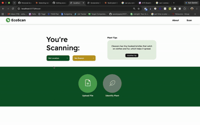

# EcoScan

A full-stack web app that identifies winter plants from photos, combining a custom TensorFlow model with the Plant.id API.

Built as part of the Hellman Experiential Science Program at Mills College (Jan - May 2025), under Professor John Alexis Gomez.

## What it does
- Users upload a plant photo and get an identification
- A routing layer chooses between my custom TensorFlow model and the Plant.id API, using the photo's EXIF metadata (GPS coordinates, timestamps) and Plant.id's confidence score
- Scan history is stored in PostgreSQL, and training data is organized in AWS S3 by season and location

## Tech stack
Python, Flask, React, TensorFlow/Keras, PostgreSQL, AWS S3, Plant.id API

## Results and limitations
The custom model was trained on a self-collected dataset of about 100 photos across 5+ species, so it underperformed the Plant.id API. That limitation is why I built the routing layer: it uses each model where it's more reliable. With more data, the custom model would be the first thing to improve.
