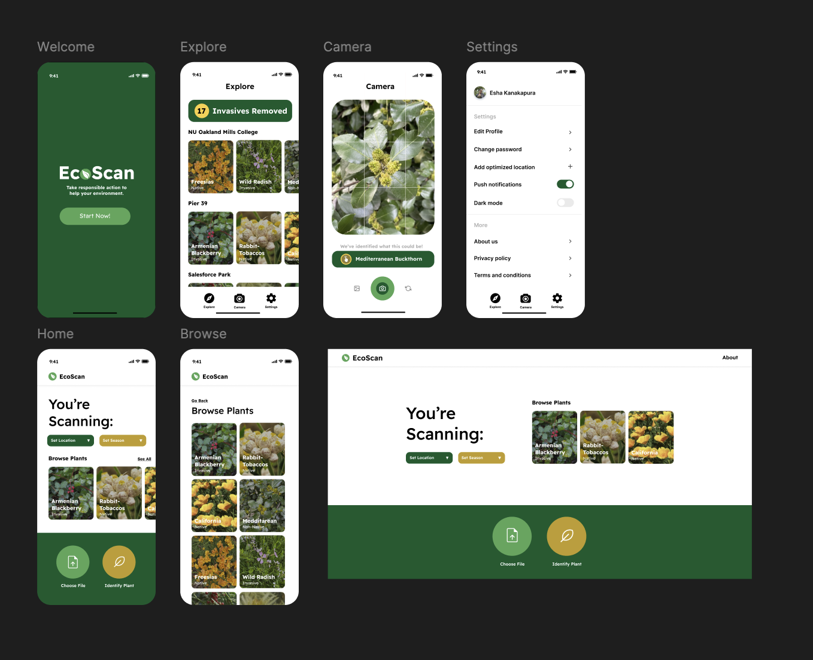

# EcoScan

EcoScan is a full-stack plant identification app built for the Hellman Experiential Science Program at Mills College (Jan-May 2025), under Professor John Alexis Gomez. Users upload a photo of a winter plant, and the app identifies it with the Plant.id API, falling back to a custom TensorFlow model trained on my own photos when Plant.id isn't confident. The app currently runs locally.

[](https://www.figma.com/design/sYk0ejj8uL6rQfFfM9JUcK/EcoScan-App?node-id=0-1&t=7gastXWuKAzApLKt-1)

## Features

* **Photo Identification:** Upload a plant photo, choose a season and location, and get a name and confidence score.
* **Confidence-Based Fallback:** If Plant.id's confidence is below 50% and the scan is a winter scan in the Boston area, the custom model takes over.
* **Scan Logging:** Each scan is saved to PostgreSQL with the plant name, confidence, image URL, season, location, and timestamp.
* **Plant Tips:** A tips section shows random facts about winter plants and invasive species.
* **Custom Model:** Trained on 283 self-collected photos across 7 plants (carrot, cleavers, English ivy, fig buttercup, garlic mustard, honeysuckle, and winter creeper), with data augmentation and an 80/20 train/validation split.

## Tech Stack

* **Frontend:** React (Vite)
* **Backend:** Flask, PostgreSQL
* **AI Integration:** TensorFlow/Keras (custom model), Plant.id API
* **Storage:** Local uploads (AWS S3 support is in the code but disabled)

## Limitations

* The custom model underperformed Plant.id, so it only runs as a fallback, and it covers just the 7 plants above.
* Season and location are chosen by the user. My first version read GPS and timestamps from photo EXIF metadata, but EXIF data was often missing or stripped, so I switched to manual inputs.
* The S3 upload code is still in the repo, but it's untested and disabled because I no longer have access to the AWS account.
* The training photos (283 images) aren't included in this repo, so the model can't be retrained from it as is. The trained model file is included in `backend/models/`.

## Setup Instructions

1. Create the database:
```bash
   createdb plant_scanner && psql plant_scanner -f schema.sql
```
2. Start the backend (Python 3.11):
```bash
   cd backend
   python3.11 -m venv venv && source venv/bin/activate
   pip install -r requirements.txt
   cp .env.example .env   # add your own PLANT_ID_API_KEY, leave the AWS values empty
   python backend.py
```
3. Start the frontend, in a second terminal from the project root:
```bash
   npm install
   npm run dev
```
4. Make sure `API_URL` in `src/PlantScanner.jsx` points to `http://127.0.0.1:5001`.
