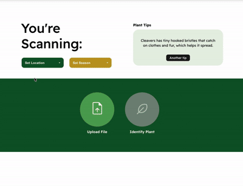

# EcoScan



A full-stack web app that identifies winter plants from photos, combining the Plant.id API with a custom TensorFlow model.

Built as part of the Hellman Experiential Science Program at Mills College (Jan–May 2025), under Professor John Alexis Gomez.

**Status:** Working locally.

## What it does
- Users upload a plant photo and choose a season and location
- The app calls the Plant.id API first. If its confidence is below 50%, and the scan is for winter in the Boston area, it falls back to my custom TensorFlow model
- Each scan is saved to PostgreSQL with its confidence, season, and location
- Uploaded images go to AWS S3 when credentials are configured and are stored locally otherwise (S3 is currently disabled because my AWS account lapsed)
- A small plant-tips section shows random facts about winter plants and invasives

## Design notes
My first version read GPS coordinates and timestamps from photo EXIF metadata to set the season and location automatically. EXIF data turned out to be unreliable (often stripped or missing), so I switched to user-selected season and location.

## The custom model
- Trained on a self-collected dataset of 283 photos across 7 species: carrot, cleavers, English ivy, fig buttercup, garlic mustard, honeysuckle, and winter creeper
- Data augmentation, 80/20 train/validation split, 10 epochs (see `backend/train_model.py`)
- The photos themselves are not included in this repo

## Results and limitations
The custom model underperformed Plant.id, which is why it runs only as a fallback. With a small dataset, it covers just 7 species. Season and location are chosen manually, and the fallback only triggers for winter scans in the Boston area. More data and species would be the first improvement.

## Tech stack
Python, Flask, React (Vite), TensorFlow/Keras, PostgreSQL, AWS S3 (optional), Plant.id API

## Running it locally
1. Create the database: `createdb plant_scanner && psql plant_scanner -f schema.sql`
2. Backend (Python 3.11):
```bash
   cd backend
   python3.11 -m venv venv && source venv/bin/activate
   pip install -r requirements.txt
   cp .env.example .env   # add your own PLANT_ID_API_KEY (leave the AWS values empty)
   python backend.py
```
3. Frontend, in a second terminal from the project root:
```bash
   npm install
   npm run dev
```
4. Make sure `API_URL` in `src/PlantScanner.jsx` points to `http://127.0.0.1:5001`.